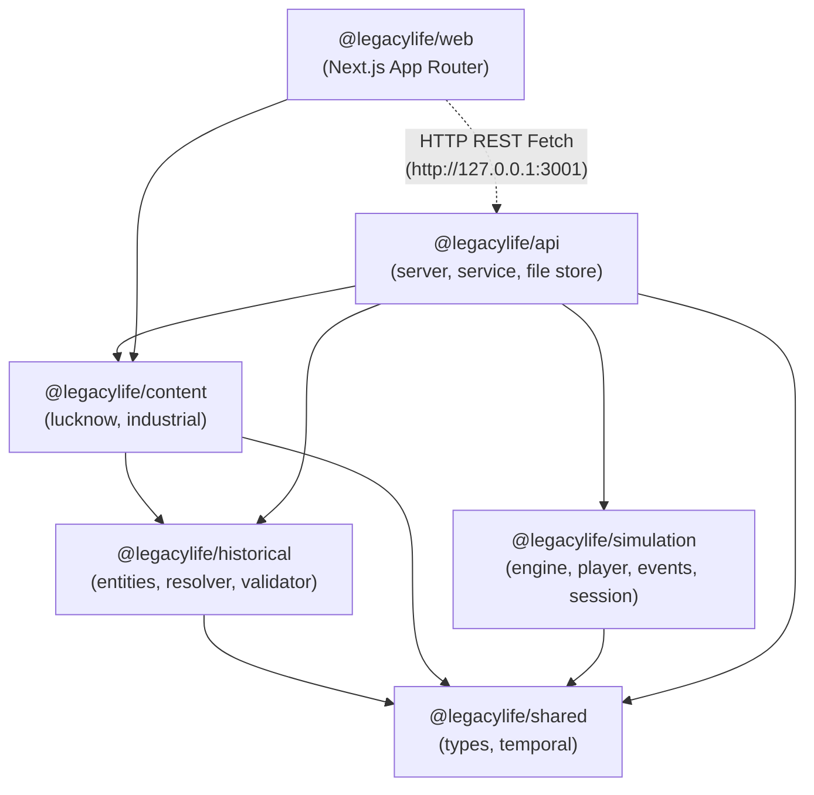
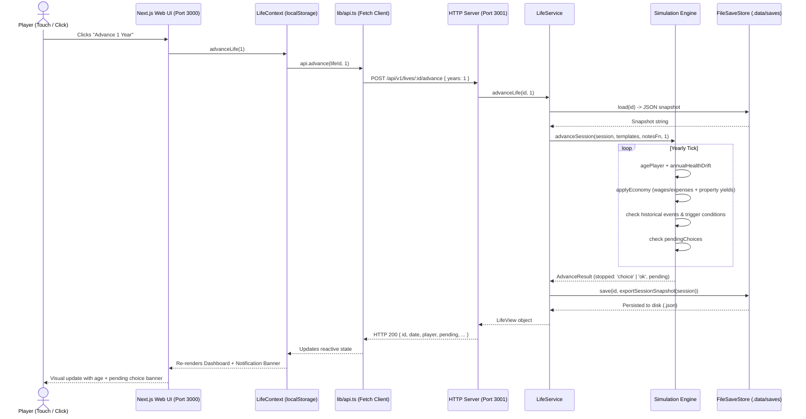

# LegacyLife — Repository Architecture & Technical Inventory

**Audit Date:** October 2026  
**Repository Path:** `d:\Another life\legacylife`  
**Toolchain:** Node.js (v22), TypeScript (v5.7), npm workspaces, Vitest (v2.1), Next.js (v14.2), tsx (v4.19)

---

## 1. Monorepo Package Topology & Dependencies

LegacyLife is organized as an npm workspaces monorepo containing 5 packages and 1 Next.js application:

```text
d:\Another life\legacylife\
├── package.json               # Root scripts, workspaces config, Vitest devDependencies
├── tsconfig.base.json         # Shared TypeScript compiler options (ES2022, NodeNext)
├── .npmrc                     # Pinned cache to D-drive (Rule 1 compliance)
├── scripts/
│   ├── vertical-slice.ts      # Standalone headless execution proof (Lucknow 1946)
│   ├── dev-api.cmd            # Windows CMD helper to launch API daemon
│   └── dev-web.cmd            # Windows CMD helper to launch Next.js dev server
├── packages/
│   ├── shared/                # Types, temporal helpers, base resolver
│   ├── historical/            # Entity schemas, context resolver, dataset validator
│   ├── content/               # Era data packs (Lucknow 1945–1970, Victorian 1840–1890)
│   ├── simulation/            # Headless engine: player, events, effects, session, RNG
│   └── api/                   # Zero-dependency HTTP server & JSON file save store
└── apps/
    └── web/                   # Next.js 14 App Router, Tailwind/Vanilla CSS, mobile shell
```

### Dependency Graph



*Note on package dependency boundary:* While the simulation package remains data-free (engine-first design), `packages/api` coordinates `@legacylife/simulation` and `@legacylife/content`. `apps/web` connects to `packages/api` primarily via HTTP `fetch`, though it also directly imports some utility helpers from `packages/content` or duplicates them in `apps/web/lib/era.ts`.

---

## 2. Package-by-Package Inventory

### 2.1 `@legacylife/shared` (`packages/shared/src`)
- **`types.ts`**: Foundational types including `DateISO` (string format `YYYY-MM-DD`), `DateRange` (`from`, `until`), `LocationEntity`, `PoliticalEntity`, `PoliticalControlRecord`, `HistoricalEventEntity`.
- **`temporal.ts`**: Pure date functions: `assertValidDate`, `withinRange(date, range)`, `cmpDate(a, b)`, `formatYear(date)`.
- **`resolver.ts`**: `resolvePoliticalEntity(date, locationId, controlRecords, entities)` resolving which political entity exercised sovereignty at a given date.
- **`seed/lucknow.ts`**: Static political control sequence for Lucknow:
  - British Raj (United Provinces): up to `1947-08-14`
  - Dominion of India: `1947-08-15` to `1950-01-25`
  - Republic of India: `1950-01-26` onwards

### 2.2 `@legacylife/historical` (`packages/historical/src`)
- **`entities.ts`**: Domain schemas with mandatory `provenance` metadata:
  - `SocialClassEntity`: class privileges, wealth brackets.
  - `OccupationEntity`: income, requirements, social class gating.
  - `TechnologyEntity`: introduction and adoption dates.
  - `DiseaseEntity`: mortality rates, endemic date spans.
  - `LawEntity`: legal constraints, enforcement dates.
  - `CultureEntity`, `ReligionEntity`.
- **`context.ts`**: `resolveHistoricalContext(date, locationId, dataset)`:
  - Evaluates `PoliticalControlRecord`, `HistoricalEventEntity`, `OccupationEntity`, `TechnologyEntity`, `DiseaseEntity`, and `LawEntity` active at the target date and location.
- **`validate.ts`**: `validateDataset(dataset)`:
  - Enforces entity uniqueness, date range chronological validity (`from <= until`), dangling ID detection, and provenance presence.

### 2.3 `@legacylife/content` (`packages/content/src`)
- **`lucknow.ts`**:
  - `LUCKNOW_DATASET`: 5 locations (`location.lucknow`, `location.kanpur`, `location.delhi`, `location.prayagraj`, `location.awadh_rural`), 3 political entities, 15 control records, 12 historical events, 8 occupations, 5 classes, 10 technologies, 6 diseases, 5 laws.
  - `lucknowYearNotes(date, locationId)`: Emits year-window historical summaries.
  - `LUCKNOW_LIFE_TEMPLATES`: 17 historical life dilemmas (Partition relief, 1950 Republic Day, 1952 elections, Gomti floods, 1965 war civil defense, etc.).
- **`industrial.ts`**:
  - `VICTORIAN_DATASET`: 5 locations (`location.london`, `location.manchester`, `location.birmingham`, `location.glasgow`, `location.yorkshire`), British Empire control records, 7 historical events, 6 occupations, 4 classes, technologies, diseases, laws.
  - `victorianYearNotes(date, locationId)`: Victorian chronicle generator.
  - `VICTORIAN_LIFE_TEMPLATES`: 11 Victorian dilemmas (Factory Act inspections, 1851 Great Exhibition, 1854 cholera outbreak, 1858 Great Stink, etc.).

### 2.4 `@legacylife/simulation` (`packages/simulation/src`)
- **`rng.ts`**: Mulberry32 32-bit seeded pseudo-random number generator; serializable state generator.
- **`player.ts`**: `CharacterState` model (attributes: `health`, `wealth`, `educationYears`, `reputation`, `properties`). Lifecycle helper `stageForAge` mapping age to bands (`birth`, `early_childhood`, `childhood`, `adolescence`, `early_adulthood`, `adulthood`, `later_adulthood`).
- **`family.ts`**: Multi-metric relationship model: `trust`, `affection`, `respect`, `conflict`, `loyalty`, `familiarity`, `dependency`, `sharedHistory`.
- **`events.ts`**: Requirements engine (`RequirementOp`, `isEligible`), probability resolver (`resolveOutcome`), scheduled event trigger evaluator (`triggerDue`), lifecycle audit log (`createEventRecord`).
- **`effects.ts`**: Consequence interpreter applying modifications to `player`, `world` flags, `family`, `relationships`, and scheduling delayed events.
- **`divergence.ts`**: Definitions for historical divergence L0–L6 with importance gating bars. *(STUB: completely disconnected from gameplay).*
- **`systems.ts`**: Education increments, occupation assignments, economic balances, and annual health drift.
- **`session.ts`**: Interactive simulation session driver (`createSession`, `advanceSession`, `pendingChoices`, `resolveSessionChoice`, `buyPropertySession`, `marryPartnerSession`, `haveChildSession`, `createHeirSession`).
- **`slice.ts`**: Autonomous headless vertical slice runner (`runLife`).

### 2.5 `@legacylife/api` (`packages/api/src`)
- **`store.ts`**: `FileSaveStore` managing file-based snapshots under `packages/api/.data/saves/`.
- **`service.ts`**: `LifeService` domain orchestrator mapping session commands to persistent snapshots and handling era-routing.
- **`server.ts`**: Zero-dependency Node.js HTTP server (`createServer`) exposing JSON REST endpoints on port 3001.
- **`serve.ts`**: Main daemon entry point.

### 2.6 `@legacylife/web` (`apps/web`)
- **Next.js 14.2 App Router** running on port 3000.
- **`app/globals.css`**: Design tokens, typography rules, mobile framing (430px Android phone container).
- **`components/AppShell.tsx`**: Android navigation dock (`Home`, `People`, `Career`, `Assets`, `More`).
- **`components/LifeContext.tsx`**: Client-side state coordinator holding active `LifeView` fetched from API and persisting `lifeId` in `localStorage`.
- **`lib/api.ts`**: Typed REST fetch client.
- **`lib/era.ts`**: Cultural, geographic, and currency metadata dictionary.

---

## 3. Runtime Entry Points & Daemon Architecture

The application requires two independent runtime processes to function as an interactive game:

| Process | Entry Script | Port | Working Directory | Persistence / Cache Location |
|---|---|---|---|---|
| **Backend API Daemon** | `tsx packages/api/src/serve.ts` | `3001` | Repo root | `packages/api/.data/saves/*.json` (Drive D) |
| **Frontend Web App** | `npm run dev --workspace=@legacylife/web` | `3000` | `apps/web` | `.next/` build cache (Drive D) |
| **Headless Slice Proof** | `tsx scripts/vertical-slice.ts` | N/A | Repo root | Writes `docs/proofs/vertical-slice-1946.md` |

### Environment Configuration & Variables
- `NEXT_PUBLIC_API_URL`: Points frontend client to backend (`http://127.0.0.1:3001` default).
- `PORT`: Configures backend HTTP server listening port (`3001` default).
- `TMP` / `TEMP`: Explicitly redirected to `D:/Another life/legacylife/.cache/tmp` per Rule 1.

---

## 4. End-to-End Runtime Data Flow



---

## 5. Architectural Violations & Structural Defects

1. **Hardcoded Era Switching in Service Layer (`packages/api/src/service.ts:40-60`)**:
   ```typescript
   export function isVictorianLocation(locId: string): boolean { ... }
   export function datasetForLocation(locId: string) {
     return isVictorianLocation(locId) ? VICTORIAN_DATASET : LUCKNOW_DATASET;
   }
   ```
   *Defect:* Violates the generic simulation engine principle (Rule 3). Era datasets and templates should be registered in an era catalog rather than hardcoded with conditional ternaries.
2. **Parallel / Duplicated Metadata Dictionary (`apps/web/lib/era.ts`)**:
   - `era.ts` duplicates locations, cities, populations, and kinship profiles client-side rather than consuming `@legacylife/historical` and `@legacylife/content`. This leads to split-brain states where frontend profiles drift from backend simulation rules.
3. **Dead / Stale Dynamic Route (`apps/web/app/[...slug]/page.tsx`)**:
   - Contains a catch-all route page despite iteration log 008 claiming it was permanently deleted.
