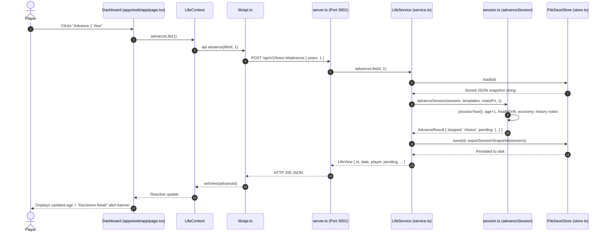
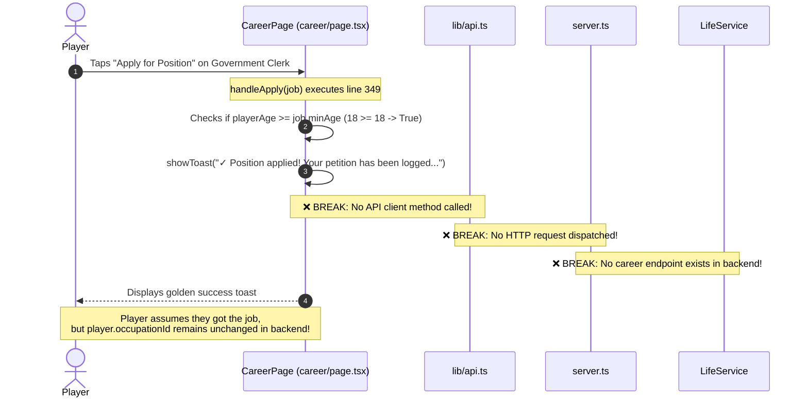
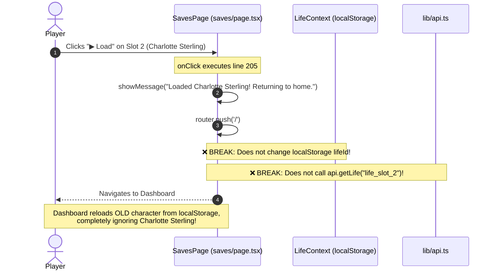

# LegacyLife — Frontend–Backend Mapping & Traceability Audit

**Audit Date:** October 2026  
**Auditor:** Full-Stack QA & Systems Architect  
**Objective:** Trace every user-facing frontend action from UI trigger down to database persistence, identifying all breaks, mock layers, and disconnected paths.

---

## 1. Master Frontend–Backend Traceability Matrix

| Feature / User Action | UI Screen & Trigger | API Client Method | HTTP Route | Backend Service & Domain Engine | Database / State Object Mutated | Response to UI | Persistence Verified? | Mapping Status |
|---|---|---|---|---|---|---|---|---|
| **Create Life (Auto / Custom)** | `/` (`page.tsx:156,171`) Click "Begin Journey" | `api.createLife` | `POST /api/v1/lives` | `service.createLife` `simulation.createSession` | Writes new `life_*.json` under `.data/saves/` | Returns initial `LifeView` | **YES** (File created on D:) | **CONNECTED (PASS)** |
| **Advance 1 Year** | `/` (`page.tsx:121`) Click "Advance 1 Year" | `api.advance` | `POST /api/v1/lives/:id/advance` | `service.advanceLife` `simulation.advanceSession` | Updates `session.player.age`, `wealth`, `timeline`, saves snapshot | Returns updated `LifeView` + `stopped` flag | **YES** (Snapshot updated on D:) | **CONNECTED (PASS)** |
| **Resolve Event Choice** | `/events` (`events/page.tsx:56`) Click "Confirm Decision" | `api.resolveChoice` | `POST /api/v1/lives/:id/events/:id/choices` | `service.resolveChoice` `effects.applyConsequence` | Executes effects; appends `EventRecord`; saves snapshot | Returns `LifeView` + `success`, `roll` | **YES** (Snapshot updated on D:) | **PARTIAL (UI DIFF MASKED)** |
| **Purchase Real Estate Deed** | `/economy` (`economy/page.tsx:35`) Click "Acquire Deed" | `api.buyProperty` | `POST /api/v1/lives/:id/properties/buy` | `service.buyProperty` `session.buyPropertySession` | Deducts cost from `wealth`; appends to `properties[]`; saves snapshot | Returns updated `LifeView` | **YES** (Asset persists and yields accrue) | **CONNECTED (PASS)** |
| **Propose Marriage** | `/people` (`people/page.tsx:49`) Click "Propose Marriage" | `api.marryPartner` | `POST /api/v1/lives/:id/marry` | `service.marryPartner` `session.marryPartnerSession` | Adds `spouse` to `family.members` and `relationships`; saves snapshot | Returns updated `LifeView` | **YES** (Spouse persists in family) | **CONNECTED (PASS)** |
| **Welcome Child into Dynasty** | `/people` (`people/page.tsx:61`) Click "Welcome Child" | `api.haveChild` | `POST /api/v1/lives/:id/children` | `service.haveChild` `session.haveChildSession` | Adds `child` to `family.members` and `relationships`; saves snapshot | Returns updated `LifeView` | **YES** (Child persists in family) | **CONNECTED (PASS)** |
| **Apply for Career Position** | `/career` (`career/page.tsx:349`) Click "Apply for Position" | **NONE** | **NONE** | **NONE** | **NONE** (No backend logic invoked) | Toast notification only | **NO** (Never persisted) | **FAKE UI / BROKEN** |
| **Perform Health Activities** | `/health` (`health/page.tsx:56`) Click "Exercise / Visit Doctor" | **NONE** | **NONE** | **NONE** | **NONE** (No backend logic invoked) | Toast notification only | **NO** (Never persisted) | **FAKE UI / BROKEN** |
| **Kinship Social Interaction** | `/people` (`people/page.tsx:199`) Click "Talk / Gift / Advice" | **NONE** | **NONE** | **NONE** | Mutates local in-memory React state (`selectedPerson.relationshipScore += 3`) | Toast notification; resets on page leave | **NO** (Reset on unmount) | **CLIENT-ONLY / BROKEN** |
| **Financial Actions (Save/Spend)** | `/economy` (`economy/page.tsx:709`) Click "Save Coin / Buy Sweets" | **NONE** | **NONE** | **NONE** | **NONE** (No backend logic invoked) | Toast notification only | **NO** (Never persisted) | **FAKE UI / BROKEN** |
| **Inspect World Conditions** | `/world` (`world/page.tsx`) View City / Cartography | **NONE** | (Backend route `/historical-context` exists) | **NONE** (Frontend bypasses backend) | None | Displays static client text from `era.ts` | **NO** (Static view) | **ORPHANED BACKEND** |
| **Load Game Save (Slots 2 & 3)** | `/saves` (`saves/page.tsx:205`) Click "▶ Load" | **NONE** | **NONE** | **NONE** | **NONE** (No backend logic invoked) | Toast: `"Loaded Charlotte Sterling!"` -> navigates to `/` | **NO** (Loads nothing) | **FAKE UI / BROKEN** |
| **Delete Saved Chronicle** | `/saves` (`saves/page.tsx:338`) Click "Delete Save" | **NONE** | (Backend route `DELETE /lives/:id` exists) | **NONE** (Frontend never calls DELETE) | None | Toast: `"Slot management active."` | **NO** (Deletes nothing) | **FAKE UI / BROKEN** |
| **Export Save Snapshot** | `/saves` (`saves/page.tsx:288`) Click "Export Save" | Native browser | `GET /api/v1/lives/:id/save` | `service.exportSave` `store.load` | Reads raw JSON snapshot from disk | Browser downloads/displays raw JSON | **YES** | **CONNECTED (PASS)** |
| **Dynastic Succession (Play Heir)** | `/legacy` (`legacy/page.tsx:65`) Click "Play as Heir" | `api.playAsHeir` | `POST /api/v1/lives/:id/heir` | `service.playAsHeir` `session.createHeirSession` | **OVERWRITES** same file `life_*.json` on disk; ancestor deleted | Returns new heir `LifeView` | **CORRUPTS/DESTROYS ANCESTOR SAVE** | **FAIL (DATA DESTRUCTION)** |

---

## 2. Sequence Diagram: Working Full-Stack Flow (Advance Time)

---

## 3. Sequence Diagram: Broken Flow (Career Application)

---

## 4. Sequence Diagram: Broken Flow (Save Slot Loading)

---

## 5. Architectural Recommendations for Contract Reconciliation

1. **Implement Missing Backend Endpoints:**
   - Add `POST /api/v1/lives/:id/career/apply` accepting `{ occupationId: string }` and validating education, age, and class prerequisites.
   - Add `POST /api/v1/lives/:id/health/activity` accepting `{ activityId: string }` and modifying health attributes with cooldowns.
   - Add `POST /api/v1/lives/:id/relationships/:relId/interact` accepting `{ action: 'talk' | 'gift' | 'advice' }` to mutate trust and affection in `family.ts`.
2. **Wire `/saves` to Real Backend Slots:**
   - Fetch actual saves using `GET /api/v1/lives`.
   - Update `localStorage.setItem('legacylife:lifeId', selectedId)` upon loading a slot.
   - Connect "Delete Save" to `DELETE /api/v1/lives/:id`.
3. **Pass Authoritative Consequence Diffs to UI:**
   - Modify `resolveSessionChoice` to return `{ appliedConsequences: Consequence[] }`.
   - In `events/page.tsx`, map the actual consequences instead of the hardcoded `+10 Wealth / +5 Knowledge` card.
