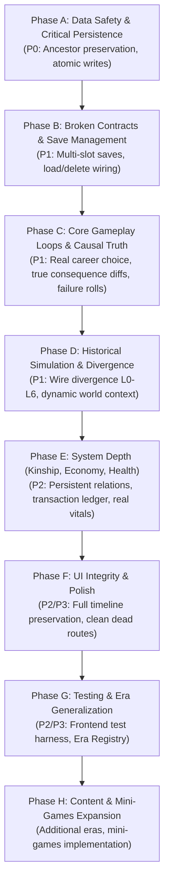

# LegacyLife — Prioritized Implementation Roadmap

**Audit Date:** October 2026  
**Strategy:** Phased, dependency-aware correction plan. Fix data safety first, repair broken contracts second, make gameplay loops genuinely causal third, and expand content last.

---

## 1. Roadmap Phase Overview

---

## 2. Phase-by-Phase Task Specifications

### Phase A: Data Safety & Critical Persistence

#### TASK-A1 — Preserve Ancestor Chronicles on Heir Succession (`P0`)
- **Problem:** `playAsHeir` overwrites the deceased ancestor's file on disk, permanently destroying their life history and achievements.
- **Affected Files:** `packages/api/src/service.ts`, `packages/simulation/src/session.ts`
- **Dependencies:** None
- **Implementation Approach:**
  1. In `createHeirSession`, assign a new unique life ID to the heir and set `session.ancestorId = ancestorSession.player.id`.
  2. In `LifeService.playAsHeir(id)`, save the heir into `store.save(heirId, heirSnapshot)` while leaving the original `id` file intact.
  3. Return the new heir's `LifeView` to the frontend, updating `localStorage`.
- **Acceptance Criteria:** After succession, the ancestor's save file still exists on disk, and the heir has an independent save file.
- **Required Tests:** Test in `service.test.ts` verifying that after `playAsHeir(id)`, `store.exists(id)` remains true and `store.exists(newHeirId)` is true.

#### TASK-A2 — Implement Atomic File Writes in Save Store (`P0`)
- **Problem:** `store.save` uses direct `writeFileSync`, risking corrupt JSON files on sudden process interruption.
- **Affected Files:** `packages/api/src/store.ts`
- **Dependencies:** None
- **Implementation Approach:**
  Write JSON snapshot to `${targetPath}.tmp`, execute `fs.fsyncSync`, and atomically replace using `fs.renameSync(tmpPath, targetPath)`.
- **Acceptance Criteria:** Save operations are atomic; crashes mid-write leave the previous valid save intact.
- **Required Tests:** Unit test in `service.test.ts` asserting atomic write behavior.

---

### Phase B: Broken Contracts & Save Management

#### TASK-B1 — Wire `/saves` to Genuine Multi-Slot Backend Storage (`P1`)
- **Problem:** UI slots 2 & 3 are hardcoded fakes; "Load" does not switch the active game; "Delete" is an inert toast.
- **Affected Files:** `apps/web/app/saves/page.tsx`, `apps/web/lib/api.ts`, `apps/web/components/LifeContext.tsx`
- **Dependencies:** TASK-A1
- **Implementation Approach:**
  1. Expose `api.listLives()` and `api.deleteLife(id)` in `lib/api.ts`.
  2. In `saves/page.tsx`, fetch actual saves from `GET /api/v1/lives` on mount.
  3. Load real character metadata for each slot.
  4. Wire "▶ Load" to call `setLifeId(slotId)` and navigate to `/`.
  5. Wire "Delete Save" to call `api.deleteLife(slotId)` and refresh slots.
- **Acceptance Criteria:** Player can view all real save files on disk, load any slot, and delete unwanted saves.
- **Required Tests:** Component integration test asserting that clicking Load updates active `lifeId`.

---

### Phase C: Core Gameplay Loops & Causal Truth

#### TASK-C1 — Authoritative Consequence Diffs in Events Outcome Screen (`P1`)
- **Problem:** Outcome screen displays hardcoded fake diffs (`+10 Wealth, +5 Knowledge`) regardless of what the engine did.
- **Affected Files:** `packages/simulation/src/session.ts`, `packages/api/src/service.ts`, `apps/web/app/events/page.tsx`
- **Dependencies:** None
- **Implementation Approach:**
  1. Update `resolveSessionChoice` in `session.ts` to return `appliedConsequences: Consequence[]`.
  2. Pass `appliedConsequences` through `service.resolveChoice` and `api.resolveChoice`.
  3. In `events/page.tsx`, replace the hardcoded card with dynamic rows rendering the actual stat deltas applied.
- **Acceptance Criteria:** Outcome screen reflects exact engine deltas (e.g. paying 20 coins shows `-20 Coins`).
- **Required Tests:** Test asserting `appliedConsequences` in `session.test.ts` and `service.test.ts`.

#### TASK-C2 — Genuine Career Applications & Occupational Transition (`P1`)
- **Problem:** "Apply for Position" in `/career` only triggers a toast; job is hardcoded at age 18.
- **Affected Files:** `packages/simulation/src/session.ts`, `packages/api/src/service.ts`, `packages/api/src/server.ts`, `apps/web/lib/api.ts`, `apps/web/app/career/page.tsx`
- **Dependencies:** None
- **Implementation Approach:**
  1. Add `applyJobSession(session, occupationId)` in `session.ts`: validates age, education, and social class; updates `player.occupationId` and `yearlyIncome`.
  2. Add endpoint `POST /api/v1/lives/:id/career/apply`.
  3. In `career/page.tsx`, wire `handleApply(job)` to dispatch the API call and refresh state.
- **Acceptance Criteria:** Player can successfully change jobs; wages and duties update on the dashboard and ledger.
- **Required Tests:** Unit tests in `session.test.ts` and integration test in `server.test.ts`.

#### TASK-C3 — Asymmetric Event Choice Failure Consequences (`P1`)
- **Problem:** Failing an event choice drops all consequences except negative wealth costs.
- **Affected Files:** `packages/simulation/src/events.ts`, `packages/simulation/src/session.ts`
- **Dependencies:** TASK-C1
- **Implementation Approach:**
  1. Add `failureConsequences?: Consequence[]` to `Choice` interface.
  2. In `session.ts:355-360`, apply `choice.failureConsequences` when `outcome.success === false`.
  3. Update event templates in `lucknow.ts` and `industrial.ts` with distinct failure consequences (health hits, loss of reputation).
- **Acceptance Criteria:** Failing a risky choice applies real penalties (e.g. contracting fever or suffering injury).
- **Required Tests:** Unit test in `session.test.ts` verifying failure consequences execute on unsuccessful roll.

---

### Phase D: Historical Simulation & Divergence

#### TASK-D1 — Connect Historical Divergence Engine (L0–L6) (`P1`)
- **Problem:** Divergence engine is completely disconnected dead code.
- **Affected Files:** `packages/simulation/src/divergence.ts`, `packages/simulation/src/effects.ts`, `packages/simulation/src/session.ts`, `packages/simulation/src/legacy.ts`
- **Dependencies:** TASK-C1
- **Implementation Approach:**
  1. Add `divergence` consequence target: `{ target: 'divergence', scope: DivergenceLevel, importance: number, originalState: string, newState: string }`.
  2. In `effects.ts`, evaluate `shouldDiverge`; if passed, append `DivergenceRecord` to `session.divergences`.
  3. Pass `session.divergences.length` to `computeLegacy`.
  4. Display recorded divergences on the `/legacy` screen.
- **Acceptance Criteria:** Making a major historical choice records an alternate timeline branch visible in legacy evaluation.
- **Required Tests:** Test in `session.test.ts` verifying divergence record generation.

#### TASK-D2 — Connect `/world` Screen to Authoritative Context API (`P2`)
- **Problem:** `/world` screen bypasses backend context resolver and renders static text.
- **Affected Files:** `apps/web/app/world/page.tsx`, `apps/web/lib/api.ts`
- **Dependencies:** None
- **Implementation Approach:**
  1. Expose `api.historicalContext(date, locationId)` in `lib/api.ts`.
  2. Wire `world/page.tsx` to fetch dynamic political control, active historical events, and local laws.
- **Acceptance Criteria:** World overview dynamically reflects historical transitions (e.g. British Raj changing to Republic of India in 1950).
- **Required Tests:** Component test for dynamic city profiles.

---

### Phase E: System Depth (Kinship, Economy & Health)

#### TASK-E1 — Persistent Kinship Interactions (`P2`)
- **Problem:** Social interactions (Talk, Gift) mutate ephemeral client objects that reset on unmount.
- **Affected Files:** `packages/simulation/src/session.ts`, `packages/api/src/server.ts`, `apps/web/app/people/page.tsx`
- **Dependencies:** None
- **Implementation Approach:**
  Add `POST /api/v1/lives/:id/relationships/:relId/interact` mutating `trust` and `affection` in backend `session.relationships`.

#### TASK-E2 — Persistent Transaction Ledger (`P2`)
- **Problem:** Transaction history in `/economy` is static dummy data.
- **Affected Files:** `packages/simulation/src/session.ts`, `apps/web/app/economy/page.tsx`
- **Dependencies:** None
- **Implementation Approach:**
  Store `transactions: TransactionRecord[]` in `SessionState`; record wages, living expenses, and property purchases.

#### TASK-E3 — Authentic Health Interventions (`P2`)
- **Problem:** Health activities are fake toast buttons; 4 of 5 vitals are hardcoded static numbers.
- **Affected Files:** `packages/simulation/src/session.ts`, `apps/web/app/health/page.tsx`
- **Dependencies:** None
- **Implementation Approach:**
  Add `POST /api/v1/lives/:id/health/activity` to allow doctor visits and medicine purchases to restore health; remove fake static vitals from UI or model them in engine.

---

### Phase F: UI Integrity & Polish

#### TASK-F1 — Full Timeline Milestone Preservation (`P2`)
- **Problem:** `LifeView` truncates timeline to last 25 entries, causing early-life milestones to vanish in older characters.
- **Affected Files:** `packages/api/src/service.ts`, `apps/web/app/life/page.tsx`
- **Dependencies:** None
- **Implementation Approach:**
  Return full structured milestones array or full timeline in `LifeView`.

#### TASK-F2 — Remove Dead Route Directory `[...slug]` (`P3`)
- **Problem:** Leftover dynamic route exists on disk.
- **Affected Files:** `apps/web/app/[...slug]/`
- **Dependencies:** None
- **Implementation Approach:** Safely remove `apps/web/app/[...slug]/` directory.

---

### Phase G: Testing & Era Generalization

#### TASK-G1 — Frontend Component Test Suite (`P2`)
- **Problem:** Zero automated tests exist for `apps/web`.
- **Affected Files:** `apps/web/`
- **Dependencies:** Phases A–C
- **Implementation Approach:** Add Vitest + React Testing Library to test key user journeys.

#### TASK-G2 — Implement Era Dataset Registry in API Layer (`P2`)
- **Problem:** Hardcoded `isVictorianLocation` ternaries in `service.ts` violate generic engine design.
- **Affected Files:** `packages/api/src/service.ts`, `packages/content/src/index.ts`
- **Dependencies:** None
- **Implementation Approach:** Replace ternaries with an extensible registry mapping location prefixes to datasets.

---

### Phase H: Content Expansion & Mini-Games

#### TASK-H1 — Convert 10 Era Specifications to Structured Data Packs (`P3`)
- **Affected Files:** `packages/content/src/`
- **Implementation Approach:** Author structured datasets for Ancient Rome/Greece, Medieval World, Renaissance, etc., per `docs/eras/*`.

#### TASK-H2 — Implement Approved Mini-Games from Catalog (`P3`)
- **Affected Files:** `apps/web/components/minigames/`
- **Implementation Approach:** Implement skill-based historical mini-games (e.g. Haggling, Chausar, Chess) per `docs/MINI_GAMES_CATALOG.md`.
